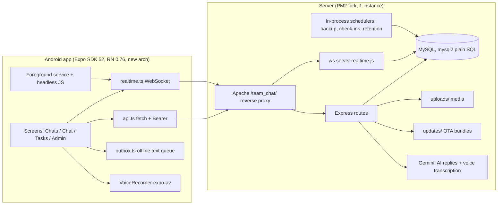

# AUDIT: Team Chat (chat + tasks), Phase 0 and the bug register

> This file is the single source of truth for findings and their status. Last update: 2026-11-20.
> The repo is public. Server addresses, ports, IPs and incident logs go in `docs/private/` (git-ignored), never here.

## 1. Architecture

- **Single process by design:** the rate limits, WebSocket client map, caches and schedulers all live in memory. Cluster mode would break them (B-26).
- **Auth:** phone + 4-digit PIN (bcrypt) issues an HS256 JWT valid 30 days. A session id gives single-device login. There is no refresh token.
- **Realtime:** ws with the token in the `Authorization` header (`?token=` fallback). The server pings every 30 s. The server dedupes messages on `(sender_id, client_id)`.

## 2. Git history
- 56 commits, one author. Four large "Round" commits (2k to 5k lines each) carry most of the risk; `1ce7517` (Round 4, 97 files) touches auth middleware, tasks, media and voice.
- Churn hotspots: `server/src/index.js`, `ai/provider.js`, `App.tsx`, `ChatScreen.tsx` (1177 lines), `AdminScreen.tsx`, `push.ts`, `routes/chats.js`.
- Secrets: no real `.env` and no key was ever committed (only `.env.example` placeholders). The local Windows user path was in docs; it was removed in `3d446b6` but is still in the old history.
- Dead code: `TasksScreenLegacy.tsx`, `TaskOverview`, `TaskBoard`, `StatusChips`, `useVoiceInput` / `VoiceBar`. `push.ts` is **not** dead: it holds the local notifications.

## 3. Requirements status (code reading plus owner reports)
✅ Working: login/activation, single session, onboarding, chats list and filters, DMs and groups, history paging, reply/quote, edit/delete (10 min), mentions, links, photos, @AI, bot task cards, admin panel, force update, OTA, theme.
⚠️ Partial: realtime (no client heartbeat, A-03); offline text queue (A-01, A-02, A-04); logout (A-05, A-06); background alerts (A-03, A-08); in-chat search (loaded messages only).
❌ Broken (owner): task self-assign (R-01); voice recording (R-02, R-05).
🚫 Not implemented: change PIN, calls, offline media queue, admin view of deleted messages.

## 4. Bug and risk register

Priority: P0 → **R-xx (owner)** → P1 → P2 → P3. "OTA" means a JS-only change; "APK" means a new native build is needed.

| ID | Area | Description | Sev | Evidence | Status |
|---|---|---|---|---|---|
| B-01 | OTA route | Unauthenticated path traversal: `/updates/assets?runtimeVersion=..&asset=../.env` serves any file under `server/` | **P0** | `routes/updates.js:10,103-105` | **Fixed** on `hardening/p0-updates-traversal` (`ead90ba`, 19 tests). **Not deployed** (server work on hold). No exploitation found in logs. |
| R-01 | Tasks | Members cannot create a task, not even for themselves; the `membersCanAssign` toggle is ignored | P1 | `tasks.js:100-102` hard-codes `isBoss` (Round 4) | Fixed (server+app, tests) (branch hardening/integration, not deployed) |
| R-05 | Voice | Recorder freezes at 0:00; cancel, lock and delete do nothing | P1 | `VoiceRecorder.tsx:63-65,83-103`: while start is pending every exit only sets a flag; no watchdog | Fixed in code (recorderEngine, tests); device check pending (branch hardening/integration, not deployed) |
| R-02 | Voice | Slow start; slide-cancel and slide-up lock unreliable; no live waveform | P1 | 4 native awaits per press; mic at the gesture-nav edge, scaled 1.35×; timer and wave depend on the status callback | Fixed in code (layout, clock timer, metering); device check pending (branch hardening/integration, not deployed) |
| V-01 | Voice + AI | A task spoken (or typed) naturally by a member is silently ignored by the AI engine | P1 | `ai/engine.js` `if (!boss) return` | Fixed (same rules as R-01, ephemeral refusal) (branch hardening/integration, not deployed) |
| V-02 | Voice + AI | A failed transcription is silent and permanent ("Transcript nahi bana"), so the AI never sees the voice note | P1 | `routes/chats.js:473-497`, `ai/transcribe.js` | Fixed (reason codes, retry endpoint, startup requeue) (branch hardening/integration, not deployed) |
| V-04 | Voice UI | No retry for a failed transcript | P2 | `VoiceBubble.tsx` | Fixed (Dobara try karo) (branch hardening/integration, not deployed) |
| R-04 | Tasks UI | No self-task composer for members; rename "Mine" to "Me"; Keep-style grid | P2 | `TasksScreen.tsx:230,238,169` | Fixed (Keep checklist cards, Me tab, composer for all, done card both ways) (branch hardening/integration, not deployed) |
| R-03 | Chat UI | Command chips are always shown; the owner wants them only while typing | P3 | `ChatScreen.tsx:876` | Fixed (focused + keyboard) (branch hardening/integration, not deployed) |
| A-01 | Outbox | Concurrent read-modify-write in AsyncStorage can lose a queued message (stuck "pending") | P1 | `outbox.ts:30-53` | Fixed (mutex queue, tests) (branch hardening/integration, not deployed) |
| A-03 | Realtime | No client heartbeat: dead socket after a network change, no reconnect | P1 | `realtime.ts:45-79` | Fixed (ping/pong both sides, tests) (branch hardening/integration, not deployed) |
| A-07 / B-02 | Auth | 30-day JWT sent in media URLs (`?t=`) and the WS fallback (`?token=`), so it lands in proxy logs and the image cache | P1 | `media.ts:43-47`, `routes/media.js:26-29` | Open: needs short-lived signed media URLs (server + app) |
| A-02 | Outbox | A message queued during a flush waits up to 15 s | P2 | `outbox.ts:42-46` | Fixed (branch hardening/integration, not deployed) |
| A-04 | Outbox | Drops items on any 4xx (including 426) with no feedback | P2 | `outbox.ts:55-57` | Fixed (failed bubble + Retry/Delete) (branch hardening/integration, not deployed) |
| A-05 | Auth | Logout does not revoke the token on the server | P2 | `auth.tsx:29-34` | Open |
| A-06 | Privacy | Logout leaves the outbox, stars and task cache for the next user | P2 | `background.ts`, `outbox.ts`, `taskCache.ts` | Open |
| A-08 / B-06 | Sync | Edits, deletes, reactions and pins missed while offline are never caught up | P2 | `chats.js:381` | Open |
| A-09 | Realtime | A stop/start race can open two sockets (duplicate notifications) | P2 | `realtime.ts:45-93` | Fixed (generation counter) (branch hardening/integration, not deployed) |
| A-10 | Composer | A double tap on Send sends the same text twice | P2 | `ChatScreen.tsx:127,348` | Fixed (send guard) (branch hardening/integration, not deployed) |
| A-12 | Voice | A failed upload loses the recording | P2 | `ChatScreen.tsx:503-521` | Fixed (voice outbox, persisted) (branch hardening/integration, not deployed) |
| A-21 | Config | `app.json` defaults to the production URL in every build | P2 | `app.json:9,77`, `config.ts` | Open |
| B-03 | Media | Any logged-in user can fetch any media file (no membership check) | P2 | `routes/media.js:77-87` | Open (with A-07) |
| B-04 | Privacy | Purged data survives in `backup/purge-*.json` etc. forever | P2 | `jobs.js:29-36` | Open (server; on hold) |
| B-05 | Sync | Catch-up `?after=` capped at 500 with no `hasMore` | P2 | `chats.js:380-382` | Fixed (hasMore) (branch hardening/integration, not deployed) |
| B-07 | Ops | No graceful shutdown; voice transcripts stay "pending" forever after a restart | P2 | `index.js` | Open |
| B-08 | Time | The DB session time zone is implicit (assumes MySQL TZ = Node TZ) | P2 | `db.js:3-10` | Open (verify on server later) |
| B-09 | Abuse | No rate limit on messages, uploads, AI calls or typing | P2 | `chats.js:498`, `media.js:48` | Open |
| B-10 | Secrets | Local `server/src/.env` holds server SSH credentials | P2 | `.gitignore`, local file | Open (owner: move to a password manager or keys) |
| A-11, A-13 to A-24 | App | Media retry duplicates, expo-av deprecated (APK), 500-row gap, token fallback, clock skew, regexes, APK URL check, perf, image cache, silent catches, dead code | P3 | see `docs/private/phase0-reports.md` | Open |
| B-11 to B-27 (except B-12, B-15, B-21) | Server | Upload type check, forged quotes, avatar from any file, task edit race, task paging, PIN lockout, phone-number privacy, boss reads DMs (disclose), new members see old history, delivered ticks, backup blocking, single-process assumptions, migration ledger | P3 | see `docs/private/phase0-reports.md` | Open |
| B-12, B-15, B-21 | Server | WS maxPayload 100 MiB; invite activation race; no JSON error handler | P3 | `realtime.js:106`, `auth.js:77-82`, `index.js` | Fixed (maxPayload 64 KiB + ws error handler, atomic invite claim, JSON errors) (branch hardening/integration, not deployed) |

Checked and fine: parameterized SQL everywhere, bcrypt PINs with a timing-safe dummy compare, HS256 pinned, membership checks on every chat route and WS event, `/media/f` path containment, message dedupe constraint, `npm audit` (server) clean.

## 5. Security (summary)
- B-01 was the only P0. It is fixed in code, with no sign of exploitation; deploy and rotation are on hold until the owner says so.
- Server hardening items found during the investigation (firewall, SSH configuration) are recorded in `docs/private/` and are on hold with the rest of the server work.
- The app has 31 npm audit findings (1 critical) in transitive Expo/RN dev tooling; triage is pending.

## 6. Tests and testability
- Before the audit: 0 tests. Now: server `npm test` (node:test + supertest; traversal suite 19/19), app `npm test` (jest-expo + RNTL) and `npm run typecheck` (0 errors), CI in `.github/workflows/ci.yml`.
- Blockers being removed: `index.js` listens and starts schedulers on import (refactor to `createApp()` in progress); module-level singletons; prod URL as the default; no testIDs.

## 7. Recording (from the read-only study of the separate recording reference)
Our app already has voice notes. The gap analysis says to borrow: a race-safe recorder state machine (sequence token, one idempotent cleanup, stop never hangs), a clock-based timer, tap mode with Cancel/Pause/Send, max-length with countdown, retry that keeps the file, magic-byte type checks and clear mic-error messages. All of these are JS-only (OTA). Background recording and moving to `expo-audio` need a **new APK**: ask the owner first. Not to copy: a permissive CORS setup, whole uploads in RAM, trusting the duration from the client, and having no retention policy.

## 8. Roadmap (local first; server work on hold by owner, 2026-11-20)
1. ✅ P0 fix in code. 2. ✅ Test harness and CI. 3. ⏳ R-01 to R-05 + A-01, A-02, A-03, A-04, A-09, A-10, A-12, B-05, B-12, B-15, B-21 (three parallel branches). 4. Emulator and real-device verification with evidence. 5. A-07/B-02/B-03 signed media URLs, A-05/A-06 logout, A-21 env profiles. 6. Remaining P2/P3. 7. On the owner's "approved": deploy, secret rotation and server hardening.

## 9. Open questions for the owner
1. R-04: send a Google Keep reference screenshot for the "identical" look.
2. Should the repo be made private? (Old history has a personal path.)
3. Server-side items are on hold: hotfix deploy, rotation, firewall and SSH.
